# Исправление цветов оружия — 2026-10-02

Исправлен поиск владельца оборудования при окраске выключенного персонажа: `GetComponentInParent<WeaponModelPresentation>(true)`. Мировые модели оружия сохраняют authored material references вместо замены на нейтрализующий шейдер тела. Модели, палитры, баланс, simulation и звук не менялись.

Исходный код: `2f19d2b107f07313d23f630b714bb4800517cf20`. Диагностика до исправления: [weapon-color-diagnostic](../weapon-color-diagnostic/README.md).

## Проверки

- `make check`: exit 0; EditMode 289/289, PlayMode 184/184, skipped/failed 0; успешная native macOS сборка.
- Новый regression падал до исправления на замене authored материала у inactive actor и прошёл после исправления. Проверяет также boost и восстановление исходных материалов.
- Существующие identity tests дополнены проверкой equipment shaders на start, boost, respawn и Repeat. Natural eight-player FFA и teams достигли terminal state.
- Точный сохранённый Player: exit 0; 24 снимка, session snapshots и material/property-block dumps. Все 24 сочетания оружия/состояния/world-own прошли проверку shader routing и красных override.
- Initial shared Player не начал capture и был остановлен только его владельцем; exclusive повтор завершился. Чужие процессы не останавливались.

Это muted диагностическая сцена с фиксированным размещением, восемью участниками, local participant 7, наблюдаемым participant 0 и часами 05:00. Damage timer задаётся snapshot как 5 секунд и затем сбрасывается в 0. Это подтверждает rendering и transitions; не заменяет human/device/performance acceptance или естественный pickup/expiry.

## Сборка для визуальной приёмки

[local-macos-player-candidate/2f19d2b107f07313d23f630b714bb4800517cf20/fix-world-weapon-colors](/Users/eaafonasev/Projects/star-tournament/.local/releases/fix-world-weapon-colors/2f19d2b107f07313d23f630b714bb4800517cf20/StarTournamentProvingGround.app)

Сборка сохранена вне worktree; точный SHA-256 исполняемого файла — в [candidate.json](candidate.json). Автоматические проверки и снимки не означают human acceptance.

## Мировое оружие

| Оружие | Обычно | Бонус | После снятия |
| --- | --- | --- | --- |
| Автомат | 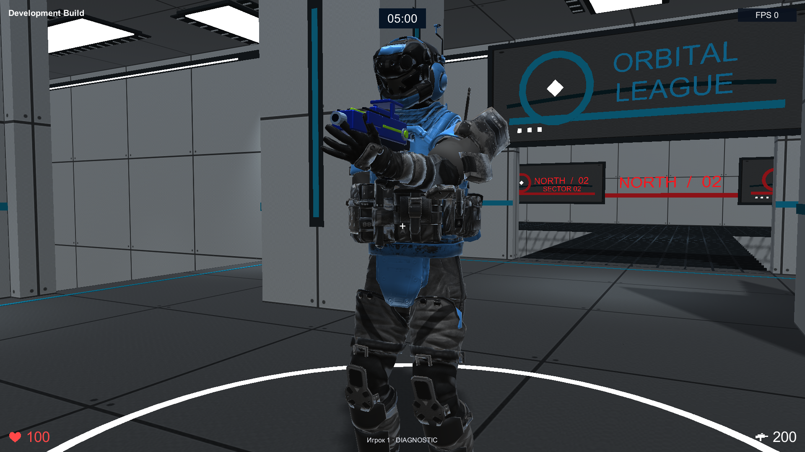 |  |  |
| Дробовик | 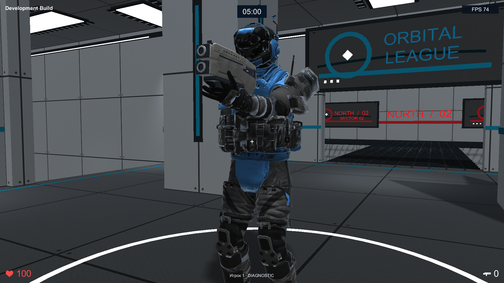 | 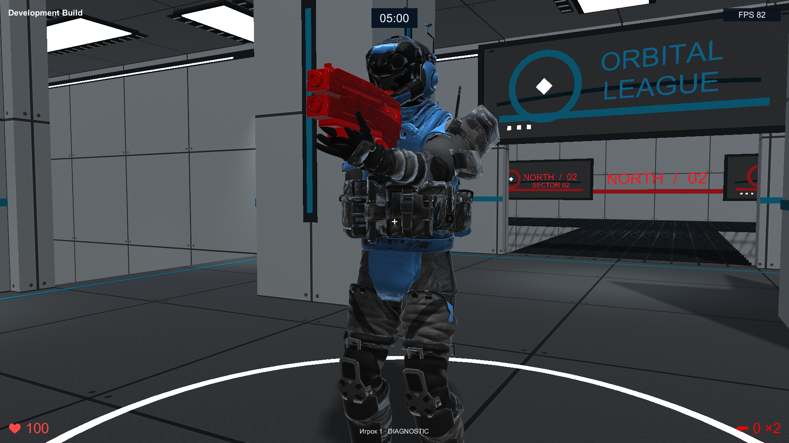 |  |
| Ракетница |  |  | 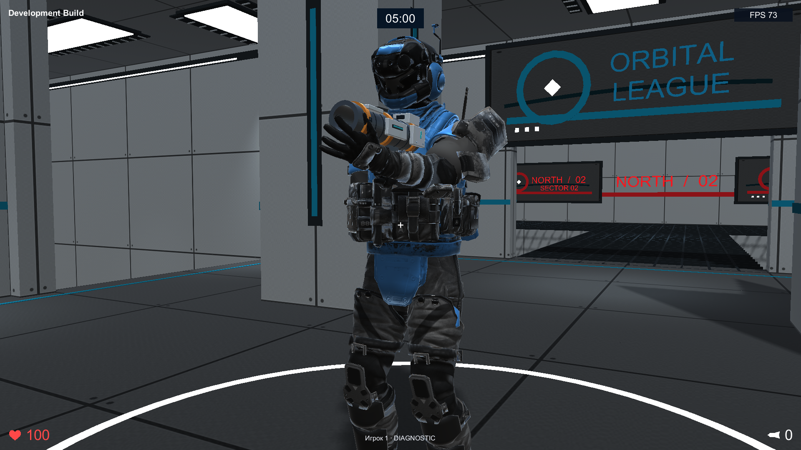 |
| Резак | 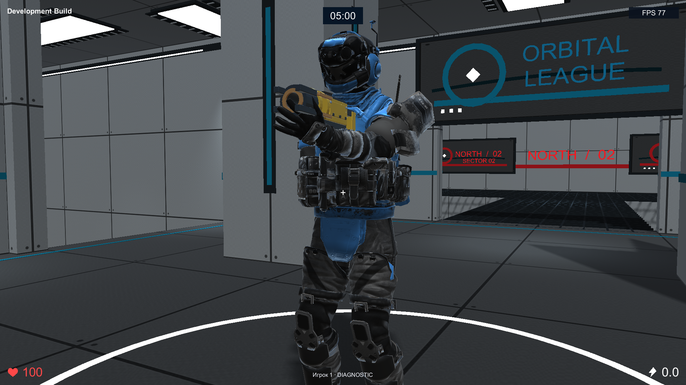 | 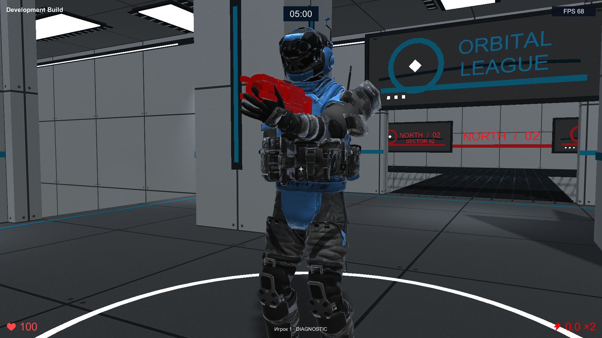 |  |

## Вид от первого лица

| Оружие | Обычно | Бонус | После снятия |
| --- | --- | --- | --- |
| Автомат |  | 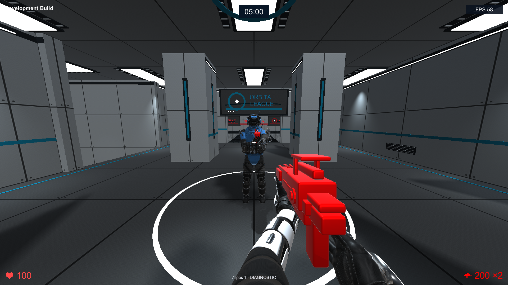 | 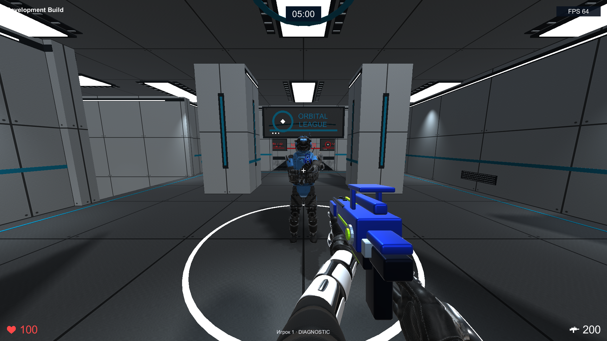 |
| Дробовик | 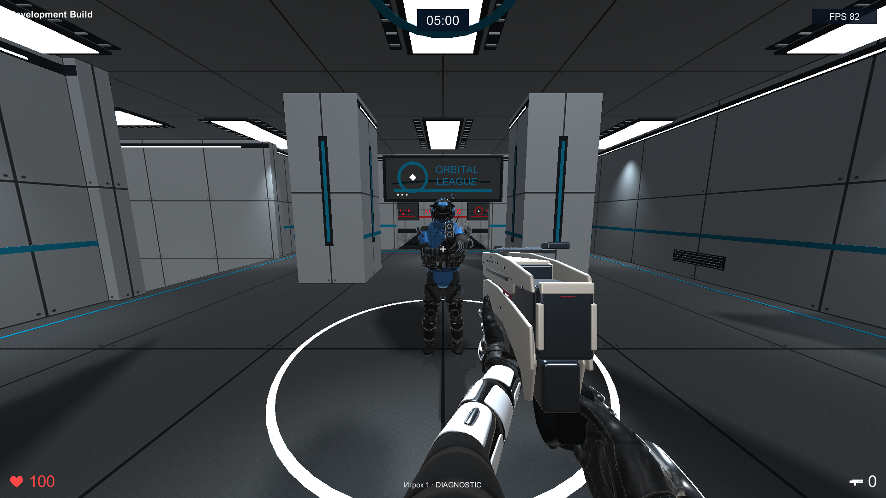 | 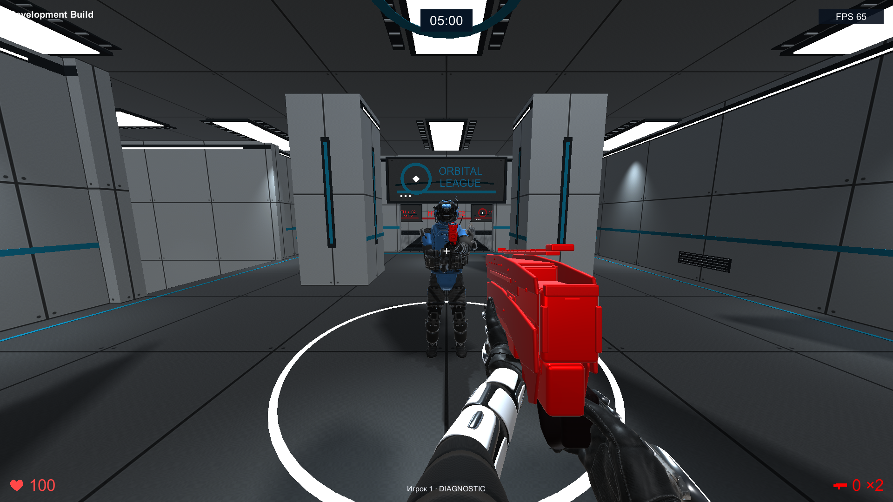 |  |
| Ракетница |  | 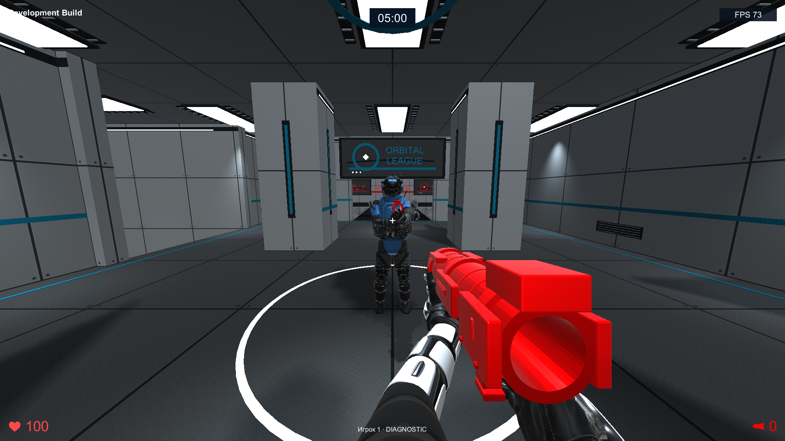 | 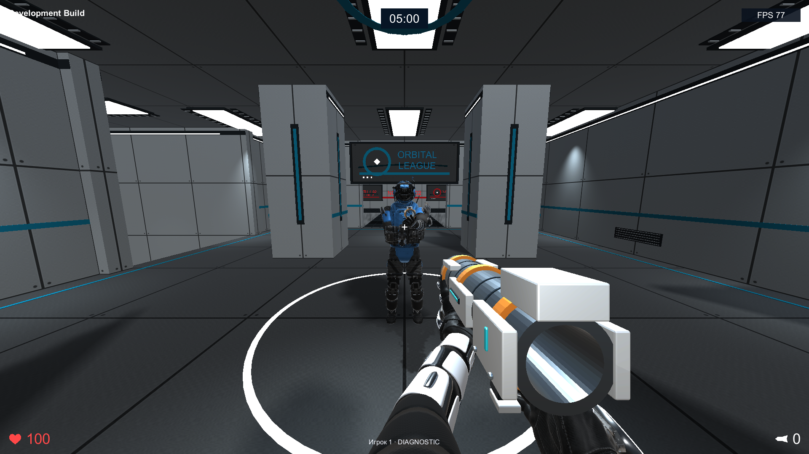 |
| Резак | 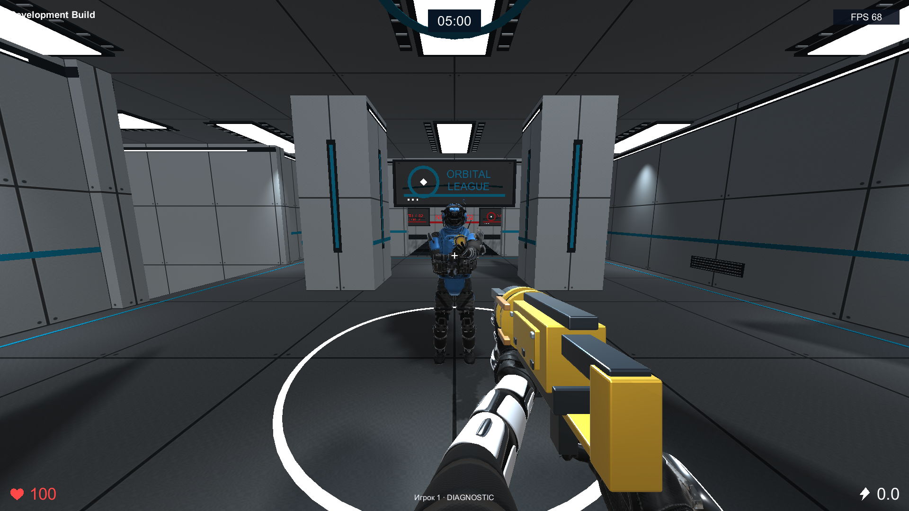 | 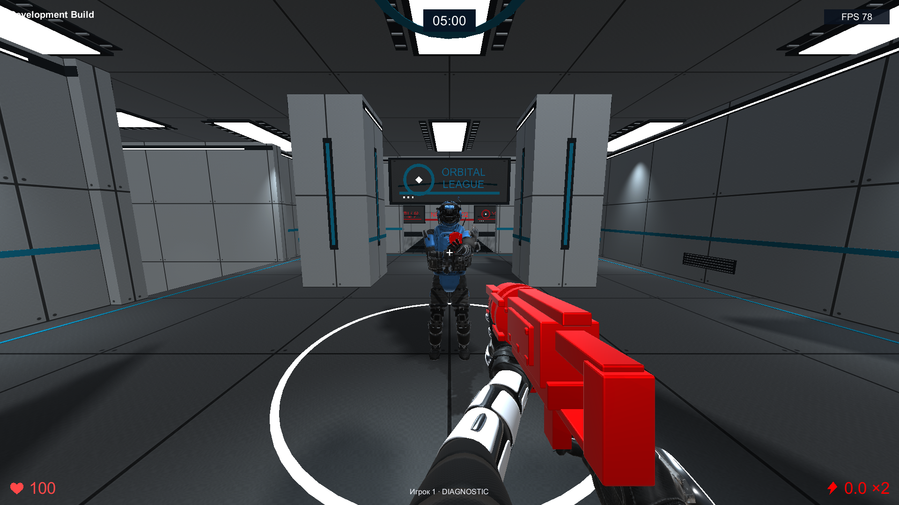 |  |
