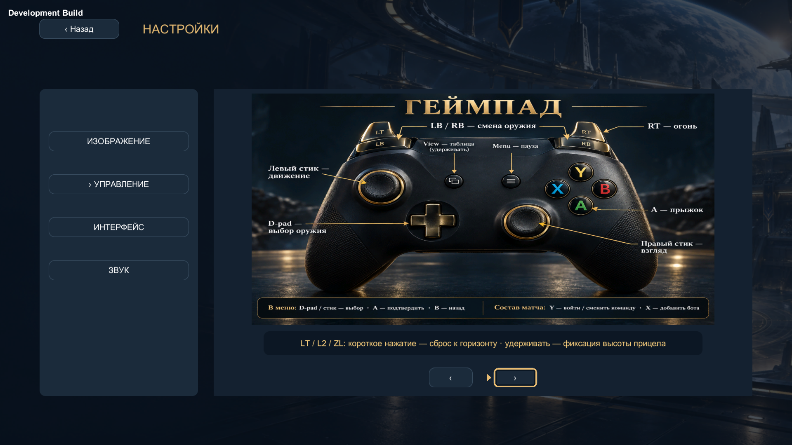

# LT: сброс горизонта и фиксация текущего угла

Исходники: `2ed666f54c6a7b3d364f45586f8343caad63996c`. Автоматическая проверка в Unity Editor; Player не собирался и не выкатывался.

Уникальное покрытие: **74 EditMode +43 PlayMode**. Исходные отказы сохранены в XML/логах: два input-теста требовали изоляции через штатный InputTestFixture; сравнение камеры/выстрела требовало нулевого разброса только в fixture. Порог и production-разброс оружия не ослаблены. Повторены целиком затронутые fixtures, неизменённые успешные проверки сохранены без лишнего полного запуска. После интеграции с новым Default v2 все 43 PlayMode-проверки прошли одним прогоном, включая 7 ProvingGroundTests. Подробности и точные команды/ревизии: verification.json.

PlayMode использует поддерживаемый STAR_TOURNAMENT_QA_LAB_HISTORY с отдельным отсутствующим файлом задачи. Assertions и состав fixtures сохранены; миграция ранее накопленной истории проверена отдельным GamepadTapThresholdAppendsCompatibleRevisionAndKeepsPriorSnapshotImmutable и полным DesignLabHistoryTests. Первый PlayMode-прогон с общей историей остановлен обычным сигналом только своему wrapper: история около160МБ вызывала повторную долгую проверку при каждой загрузке сцены. Пользовательская история не очищалась. Скорость работы такой большой истории и вклад нового параметра не измерены; это не performance acceptance.

Снимок показывает новую подпись под полной схемой геймпада; прежняя строка управления меню читается. Метка Development Build принадлежит Editor-сценарию и не означает сборку Player.

Открыты: удобство с физическим геймпадом, human acceptance, native Player/device acceptance. Player/release/build/publication остаются отложенными до отдельной команды по решению08.10.2026. Аудио QA не затронуто; Editor был заглушён штатным muteReview.
