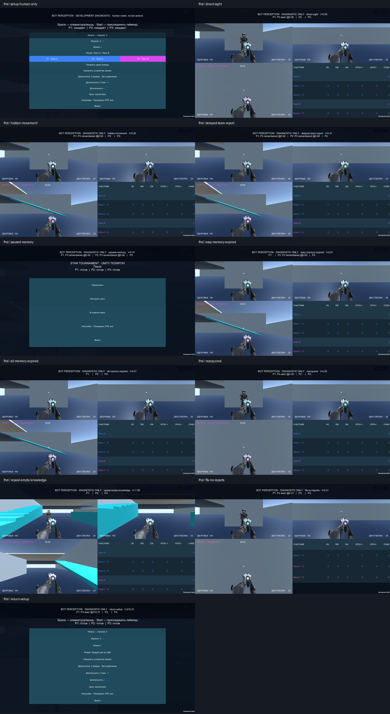

# Unity bot perception — 2026-09-20

Проверен внутренний срез `add-unity-bot-perception` на базе `4521a7d`, ветка `codex/unity-native-bots`, worktree 292d. Профиль `unity-bot-perception-v1@1`, Unity 6000.3.23f1, Mac Development Player. [Build identity](identity.json).

## Результаты

- EditMode **50/50**, PlayMode **36/36**, Mac build **PASS** (459182721 reported bytes).
- Baseline был 41/41 + 32/32. Девять новых EditMode проверок: профиль/заморозка, expiry, original timestamp/delayed reports, отсутствие starvation/relay, приоритет свежего наблюдения, FFA isolation, собственная жизнь, snapshot JSON/aliasing, атомарное отклонение невалидных данных.
- Четыре новых PlayMode проверки: настоящий WorldLayer blocker, hidden movement/death/respawn, slab и movement-only barrier, reacquisition, горизонтальные FOV границы 60°/70° трёх сложностей, delayed team reporting. Fixture geometry и мотор — настоящие Unity-компоненты.
- Native review **11 PNG + 11 JSON на каждом разрешении**: 1920×1080 и 3840×2160. Все JSON подтверждают focus и mute. Все состояния визуально просмотрены в contact sheets; hidden-movement осмотрен отдельно. Runtime exceptions отсутствуют.
- [CUA smoke обычного Player](cua-journey.md): keyboard join, three-human teams setup, существующая camera diagnostic, pause, Repeat, menu, Exit.
- Read-only Astra memo до решения и review реализации: блокирующих замечаний нет; добавлен geometry test границ FOV. Strict OpenSpec и diff check проходят.

## Native состояния

| Состояние | Доказательство |
| --- | --- |
| setup-human-only | Диагностический sensor не добавляет ботов/устройств в setup |
| direct-sight | P1 видит P3; P2 ещё не получил сообщение |
| hidden-movement | P3 переместился за solid-window; P1 хранит старую позицию |
| delayed-team-report | P2 получил старую позицию с исходным временем 0, без visible-флага |
| paused-memory | Пауза human session и отсутствие нового Sample сохраняют знания |
| easy-memory-expired | Easy уже забыл; normal ещё помнит то же исходное наблюдение |
| all-memory-expired | Получение сообщения не продлило срок памяти |
| reacquired | Новое прямое наблюдение обновило position/time |
| repeat-empty-knowledge | Review создаёт новый sensor для нового human session |
| ffa-no-reports | Тот же sensor в FFA не передаёт знания другому наблюдателю |
| return-setup | Human setup остаётся доступным |

Полные файлы — [FHD](fhd/) и [4K](4k/). Обзоры: [FHD contact sheet](fhd-contact-sheet.png), [4K contact sheet](4k-contact-sheet.png).

## Performance diagnostic

| Output | samples | p50 | p95 | p99 | worst |
| --- | ---: | ---: | ---: | ---: | ---: |
| FHD | 10000 | 0.0043 ms | 0.0058 ms | 0.0091 ms | 1.2064 ms |
| 4K | 10000 | 0.0045 ms | 0.0061 ms | 0.0103 ms | 1.3038 ms |

Это время синхронного Observe+Sample трёх наблюдателей после warmup: реальные PhysicsScene rays и memory/report processing, stationary human bodies. Mac14,10 / Apple M2 Pro / macOS 14.6.1. Это не frame time, не GPU time, не полный AI workload и не длительная 60 FPS приёмка. GPU timing здесь недоступен. Объём всей выделенной Unity памяти около 69 MB зафиксирован в JSON; это не per-sample allocation metric. Обычный Player не запускает sensor автоматически, поэтому его per-frame overhead отсутствует вне opt-in review.

## Границы доказательства

Diagnostic использует явно управляемые позы и отдельную observation timeline, а не полный матч с ботами. Pause доказывает отсутствие aging без Sample; Repeat — ручное создание нового knowledge instance в review. Lifecycle shipping sensors ещё не подключён. Snapshot восстанавливает только perception state при том же потоке наблюдений, не полный Unity replay. Torso-ray — исходная модель датчика, не распознавание каждой открытой части тела.

Открыты playable AI (planner, navigation, weapon policy, support, setup, strength evaluation), solo, восемь scene participants, real gamepads/TV, художественная приёмка trooper, reference hardware/quality/internal scale и длительный foreground 60 FPS. Известный секундный frame spike прошлого teams-среза здесь не расследован и не объявлен исправленным.

Полный архив с Player zip и Unity/native logs: `/Users/eaafonasev/Documents/Codex/qa-vault/star-tournament/bot-perception-2026-09-20`. SHA256 manifest хранится в архиве. Main/archive/deploy не выполнялись.
