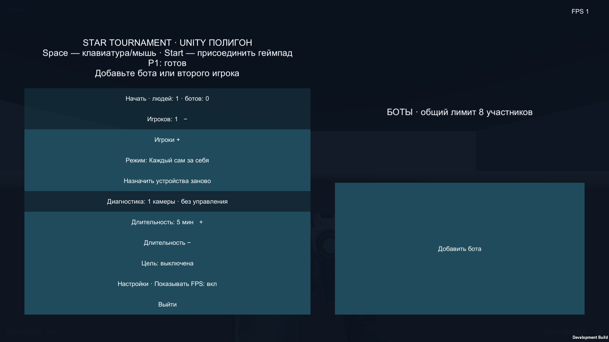
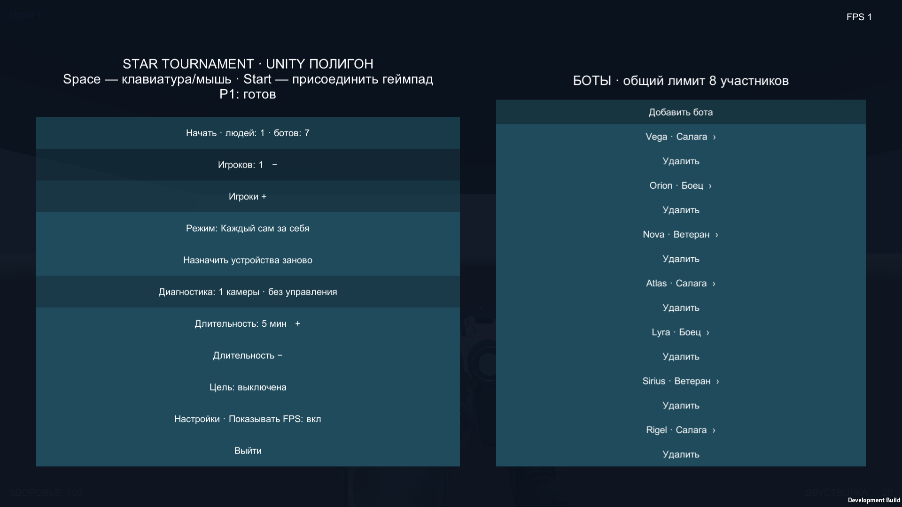
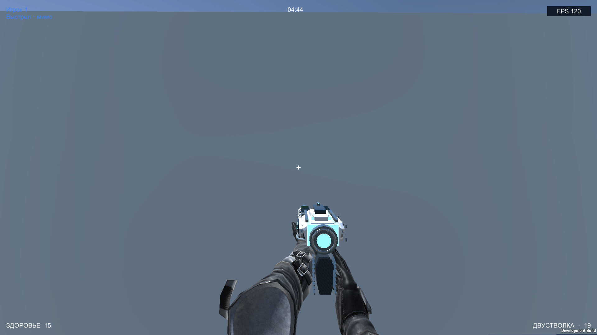
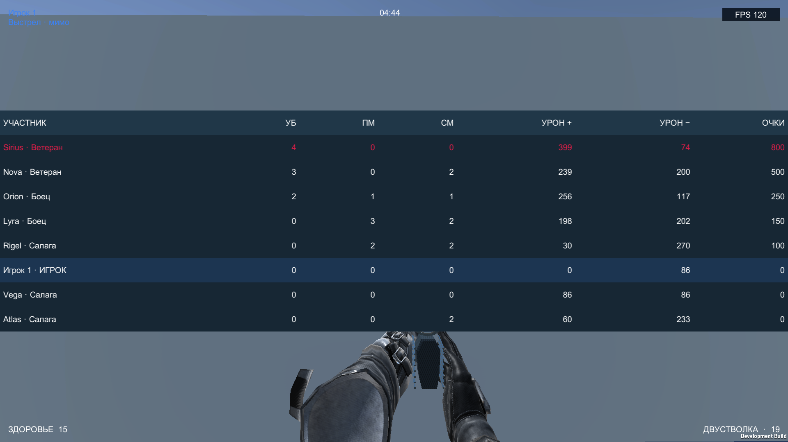
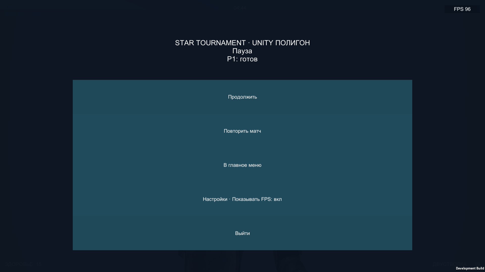
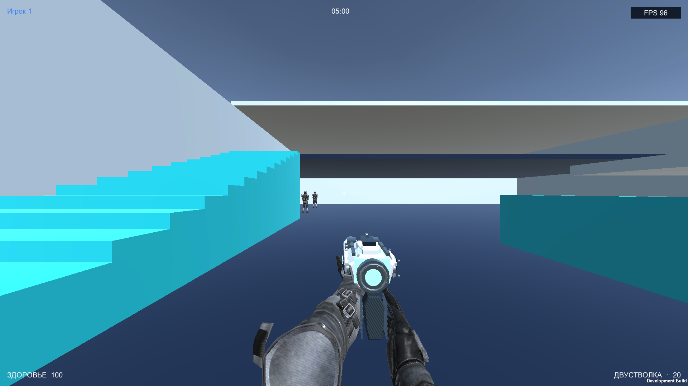
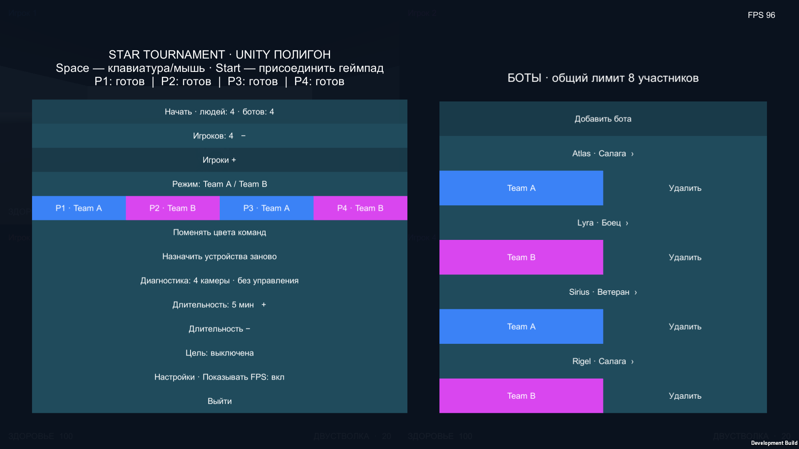
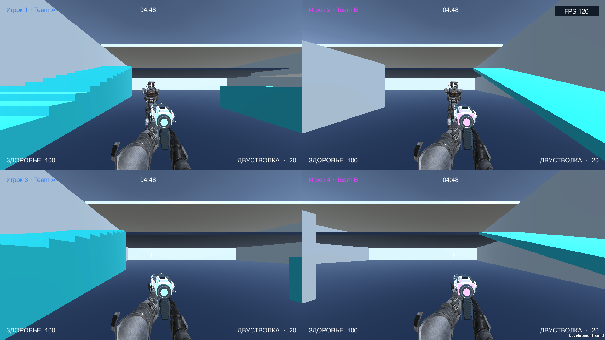
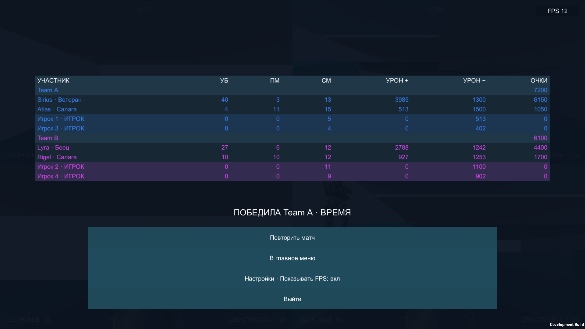
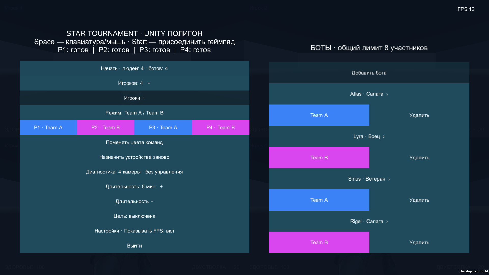

# Unity bot setup — проверенный срез

Change `add-unity-bot-setup`, branch `codex/unity-bot-setup`, base `d4844e4`. Обычный setup: 1–4 людей, 2–8 участников, индивидуальные сложности и команды ботов. Все тела/руки используют общий TrooperVisual и сохранённые семь v2 clips, root motion выключен. Хеши runtime и clips — `identity.json`.

## Проверки

- Unity 6000.3.23f1: EditMode **77/77**, PlayMode **61/61**, Mac Development build **PASS**, OpenSpec strict **PASS**.
- Новые тесты: границы состава, solo validation, frozen copy, все human counts/difficulties, обе команды, ordinary device join/Start, восемь тел/одна камера, pause/Repeat/cleanup, human-only regression и сохранение UI focus после удаления.
- `fhd/` и `4k/`: по 10 PNG + JSON финальной сборки. Все кадры focused и muted; фактические размеры 1920×1080 и 3840×2160. Native UI Buttons и synthetic gamepad joins/actions; StartBotReview не вызывается.
- FHD solo seed1778268033: 95 выстрелов за 16.22 s; teams seed519144164: естественный результат на 300 s, 806 выстрелов. 4K solo seed2075917601: 93/16.24 s; teams seed217721177: 759/300 s. Результаты получены actual AI через общий combat, без scripted damage. Seeds выбираются обычным стартом, Repeat сохраняет seed и frozen composition.
- Дополнительный CUA smoke в 4K через обычное меню: уменьшение до одного человека, reset devices, Space join keyboard/mouse, Start, W/click, Escape, Resume, повторный click. На экране подтверждены pause, возврат в бой и «Выстрел · мимо». Это короткая автоматизированная проверка, не физическая приёмка.
- PNG просмотрены: setup/validation, сложности, команды, live/results, paused/repeat и четыре viewport. Восемь строк читаемы; обрезания нового setup не обнаружено. Кадр FPS после ускоренного результата не является измерением производительности.

## Галерея состояний

Каждое состояние сохранено в обоих разрешениях; ниже FHD.

## Открытые gates

Физические 4 устройства/reconnect/TV, art acceptance, reference hardware и target 60 FPS, paired statistical difficulty acceptance, generated arenas, полный Balance Lab/replay и full migration остаются открытыми. Этот прогон не является benchmark. Не выполнялись archive, main integration или deploy.
