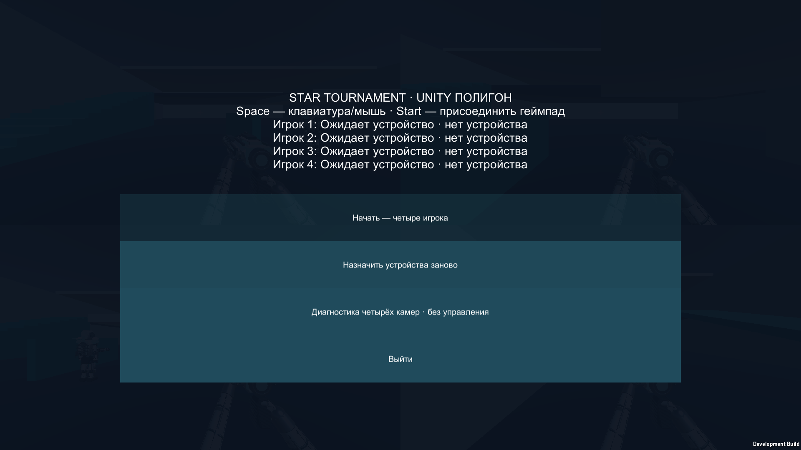
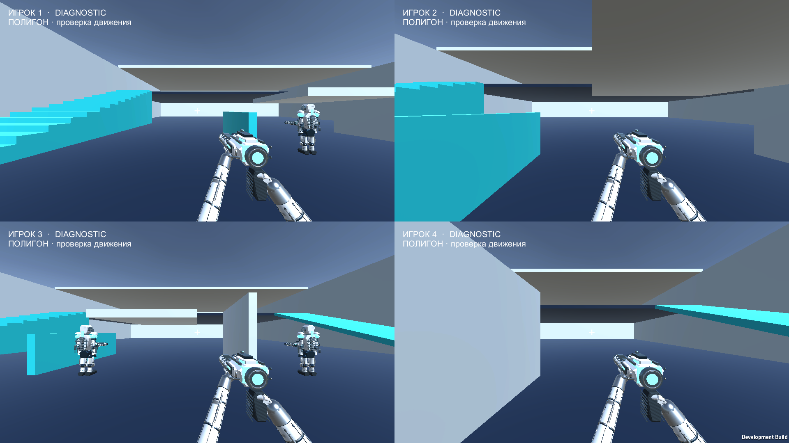
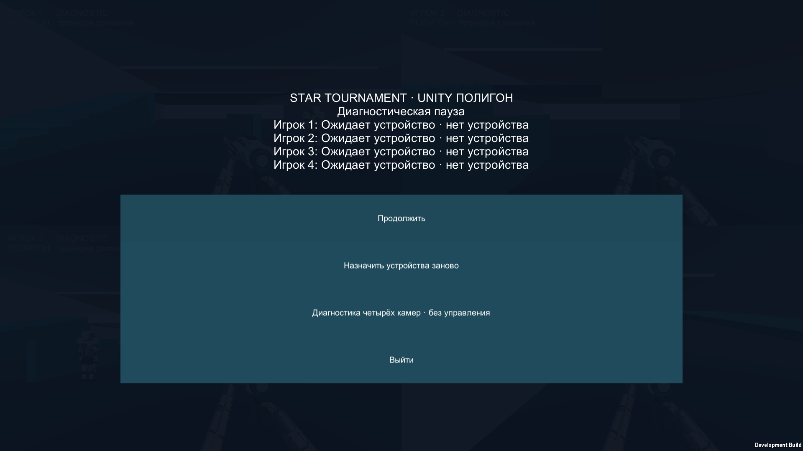

# Native Player diagnostic — 2026-09-19

**DIAGNOSTIC_NOT_ACCEPTANCE**. M2 Pro / 32 GB, Unity 6000.3.23f1 Development Player, renderScale 1, MSAA 1. Четыре неподвижных участника; 3 s warmup + 10 s measurement. Focus не сохранялся весь интервал.

| Output | Cameras | Frame p50 ms | p95 ms | p99 ms | Worst ms | GPU p95 ms (raw) |
|---|---:|---:|---:|---:|---:|---:|
| 1920×1080 | 1 | 8.43 | 13.49 | 16.54 | 22.66 | 5.66 |
| 1920×1080 | 2 | 8.40 | 13.44 | 15.71 | 19.02 | 5.50 |
| 1920×1080 | 4 | 8.34 | 13.36 | 15.61 | 23.39 | 6.72 |
| 3840×2160 | 1 | 8.38 | 13.03 | 20.98 | 25.64 | 5.73 |
| 3840×2160 | 2 | 8.42 | 13.61 | 16.87 | 23.15 | 5.79 |
| 3840×2160 | 4 | 8.34 | 13.34 | 15.81 | 23.04 | 5.35 |

CPU/GPU — raw asynchronous FrameTimingManager samples без timestamp correlation с окном. CPU worst до 468 ms расходится с frame worst: точная интерпретация требует Profiler capture. Эти цифры не подтверждают минимум 60 FPS.

Полные identities, tests и ограничения: [summary.json](summary.json). [Handoff](../../tasks/15-unity-four-player-proving-ground.md).

Фиксированная authored fixture, профиль `unity-proving-ground-v1@1`, без procedural seed.

