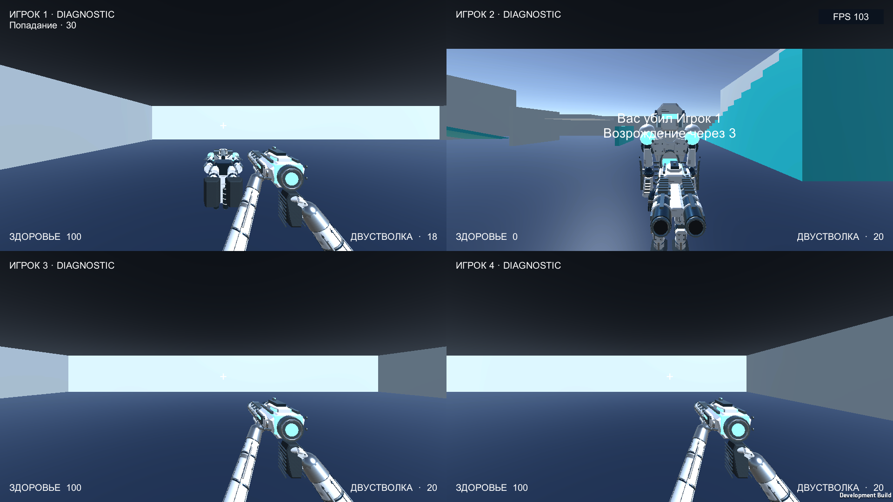
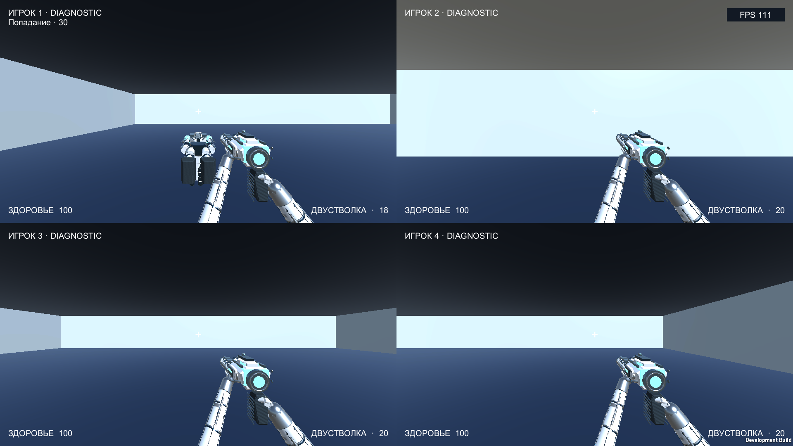
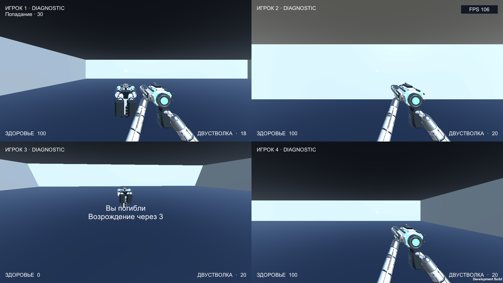

# Unity native combat — 2026-09-19

**PASS для реализации и native diagnostic. Physical/performance acceptance открыта.** Ветка `codex/unity-native-combat`, исходный parent `a3a95e9`; source hashes и Player content-manifest hash находятся в [summary.json](summary.json). Unity 6000.3.23f1, URP 17.3.0, Mac Development Player. Профили: `unity-proving-ground-v1@1`, `unity-combat-state-v1@1`, `unity-native-combat-v1@1`.

## Результат проверки

- EditMode **17/17**, PlayMode **17/17**, Mac build PASS. Полные XML/logs и manifest: `.local/unity-evidence/native-combat-final/` текущего worktree.
- В обоих разрешениях реальные input adapter → session → pellet resolver дают первый выстрел **70 damage / 30 HP**, второй — смерть и **30 applied damage**. Ammo стрелка 20 → 19 → 18. Killcam показывает `Вас убил Игрок 1`, viewmodel/crosshair жертвы скрыты.
- Pause и paused-timers JSON имеют одинаковые session time и life state. Resume приводит к life 2, 100 HP и 20 ammo; capsule возвращается в безопасном месте.
- Отдельный **явный world-damage fixture** вызывает смерть без killer для проверки orbit; это не выдаётся за weapon hit. Затем life 2/full health также восстановлены.
- Синтетические четыре gamepads проходят обычный seat input, menu pause/resume и combat. Это не четыре физических устройства. Native окно было в foreground во всех сохранённых состояниях и в измерительном окне.
- Дополнительно через native UI вручную выполнены обычный setup, Space keyboard/mouse join, недоступность Start при трёх пустых slots, diagnostic live, Escape pause, явный Resume и выход. FPS/материалы/HUD видимы; аудиовывод muted.

## Скриншоты

| Состояние | Full HD 1920×1080 | 4K 3840×2160 |
|---|---|---|
| Setup | [PNG](fhd/setup.png) | [PNG](4k/setup.png) |
| Живой HUD | [PNG](fhd/live.png) | [PNG](4k/live.png) |
| Повреждение | [PNG](fhd/damage.png) | [PNG](4k/damage.png) |
| Killcam убийцы | [PNG](fhd/killcam.png) | [PNG](4k/killcam.png) |
| Pause | [PNG](fhd/pause.png) | [PNG](4k/pause.png) |
| Respawn | [PNG](fhd/respawn.png) | [PNG](4k/respawn.png) |
| No-killer orbit | [PNG](fhd/no-killer-orbit.png) | [PNG](4k/no-killer-orbit.png) |
| Завершение сценария | [PNG](fhd/complete.png) | [PNG](4k/complete.png) |





## Ограниченная timing-диагностика

M2 Pro, четыре камеры, renderScale 1/MSAA 1. Warmup 3 s, measurement 10 s. **Это смешанный live/pause сценарий с синхронными затратами захвата PNG**, а не чистый benchmark и не финальный performance gate.

| Output | Frames | Frame p50 | p95 | p99 | Worst |
|---|---:|---:|---:|---:|---:|
| Full HD | 1023 | 8.34 ms | 14.69 ms | 22.70 ms | 67.07 ms |
| 4K | 826 | 8.69 ms | 15.61 ms | 182.97 ms | 217.43 ms |

Raw [Full HD timing](fhd/timing.json) и [4K timing](4k/timing.json) сохраняют legacy FrameTimingManager CPU/GPU values. Они асинхронны, **не связаны timestamp с measurement window и не являются синхронными performance metrics**. Никакого вывода о выполнении 60 FPS acceptance из них или FPS overlay не делается. Нужны отдельный foreground capture без PNG, reference hardware/quality/internal scale и длительная игра четырьмя людьми/TV.

## Воспроизведение

`unity/tools.sh test-edit`, `unity/tools.sh test-play`, `unity/tools.sh build` — последовательно, без второго Editor/Player benchmark одновременно.

```sh
unity/Builds/StarTournamentProvingGround.app/Contents/MacOS/'Star Tournament Unity Proving Ground' \
  -combatReview -combatEvidence /absolute/evidence/fhd \
  -probeEvidence /absolute/evidence/fhd/timing \
  -screen-width 1920 -screen-height 1080 -screen-fullscreen 0
```

Активировать окно сразу после запуска. Для 4K заменить размеры на 3840×2160 и evidence directory. Проверять фактические размеры/focus/переходы в JSON. CLI helper существует только в Editor/Development builds; production gameplay не генерирует синтетические команды.

Открыты Stage 0 physical/performance gates; full match/scoring/results/repeat, teams/bots и layouts продолжаются отдельными срезами. Integration/archive/deploy не выполнялись.
